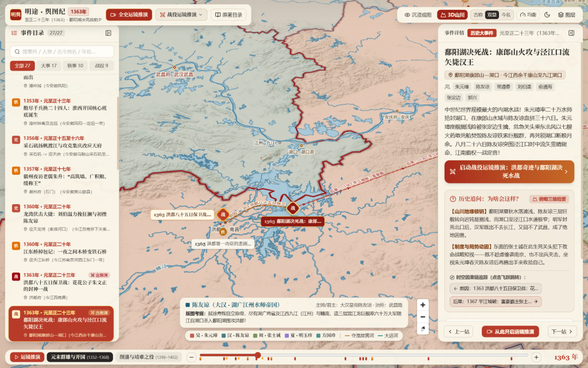

# 《明朝那些事儿》三维历史地图与战役推演系统 · 明途舆图纪 (Those Stories of Ming 3D Historical Atlas)

> **《明朝那些事儿》配套开源三维交互式历史地图（1344–1662）**：读当年明月《明朝那些事儿》，在三维山川地形上直观纵览大明三百年政权疆域擦写演变、战役行军路线动态箭头、3D 自动运镜推演、古今地名穿透对照与「为啥会这样？」深层历史因果图谱。  
> *An open-source 3D WebGL interactive historical map, dynamic marching-route replay engine, 3D camera choreography director, and causal narrative graph inspired by Dangnian Mingyue's **Those Stories of Ming (《明朝那些事儿》)**.*

[](./LICENSE)
[](https://github.com/aliceworkhard/Those-Stories-of-Ming-map/releases)
[](https://those-stories-of-ming-map.vercel.app)
[](https://linux.do/t/topic/3236921)
[](https://linux.do/)
[](https://nextjs.org/)
[](https://maplibre.org/)

🌐 **在线交互体验（免安装即开即用）**：[<kbd>🚀 打开三维历史地图</kbd>](https://those-stories-of-ming-map.vercel.app) · **[https://those-stories-of-ming-map.vercel.app](https://those-stories-of-ming-map.vercel.app)**

💬 **LINUX DO 交流专帖 & 友情链接**：[<kbd>🔥 前往 LINUX DO 专帖讨论</kbd>](https://linux.do/t/topic/3236921) · **[https://linux.do/t/topic/3236921](https://linux.do/t/topic/3236921)** · [<kbd>💛 LINUX DO 社区主页</kbd>](https://linux.do/) · **[https://linux.do/](https://linux.do/)**



---

## 为什么做这个《明朝那些事儿》历史地图项目？

很多读者在阅读当年明月所著的 **《明朝那些事儿》**（全七部，从朱元璋一只破碗走淮西到崇祯煤山落幕）时，常常会在脑海中浮现这些空间与因果疑问：

- **版图是怎么一步步擦写出来的？** 元末韩宋、陈友谅大汉、张士诚东吴、明玉珍大夏与朱元璋吴国各自盘踞何处？洪武北伐与永乐北征后，大明实控两京十三省与奴儿干都司、朵颜三卫、乌思藏都司的虚实边界究竟长什么样？
- **行军路线怎么走、仗为什么这么打？** 为什么陈友谅六十万水师会被困死在洪都孤城下？朱棣靖难之役为什么要千里奇袭大宁裹挟朵颜三卫骑兵？徐达北伐为何严禁直扑元大都，而要先取山东、再定河南、最后水陆并进克通州？
- **“为啥会这样？”背后的山川与制度锁钥是什么？** 为什么 1399 年朱棣把宁王与大宁都司内迁保定，会在整整 47 年后埋下 1449 年明英宗「土木堡之变」京师门户洞开的伏笔？

**《明途 · 舆图纪》（`Those-Stories-of-Ming-map`）** 正是为《明朝那些事儿》读者与明史爱好者打造的**开源三维时空伴读舆图**。

---

## 八大核心能力 (Key Features)

### 1. 平稳无眩晕 3D 运镜推演与「胜利方版图涂抹覆盖」
- **🎬 全史编年自动推演**：一键开启编年史自动巡礼（默认无缓存时从 **1344 年全书开篇 · 至正四年黄河决堤** 起讲，直至 **1662 年郑成功收复台湾与徐霞客终章**，自动记忆阅读进度），镜头正北向平稳飞跃山河关隘，跨时期自动触发**胜利方水墨锋面版图涂抹覆盖**。
- **⚔️ 战役分步先后箭矢推演（`① → ② → ③`）**：严格遵循历史战术先后顺序逐条推进主力箭、水师远洋箭、奇袭迂回箭与败退线，决胜幕实时演示胜利方色彩席卷涂抹败方版图。

### 2. 内置开源 Web GIS 双创作工坊——「舆图画笔擦写工坊 (`/dev/territory-painter`)」与「可视化战役投稿工坊 (`/dev/campaign-builder`)」
- **疆域擦写工坊 (`/dev/territory-painter`)**：支持直接继承任意历史切片或新建画布，使用可调半径水墨画笔**布尔涂抹扩张（Union）**与**橡皮擦除（Difference）**，底层绑定 Natural Earth 10m 陆地掩膜实现**海岸线自动锁边**与**多政权边界自动互斥零重叠**，支持考据底图半透明叠印描摹与 `TopoJSON` 导出。
- **战役投稿工坊 (`/dev/campaign-builder`)**：零代码点选地图即可绘制分步有序行军曲线、放置交战印章、实时预览动态/静态箭矢推演，并一键导出标准合规 `cmp-*.json` 提交社区 PR。

### 3. 十五期高精度州府拓扑疆域（1344–1662 无缝覆盖）与明代古水系还原
- **州府级拓扑擦写版图**：完整内置 **1356 / 1363 / 1368 / 1388 / 1399 / 1402 / 1415 / 1435 / 1449 / 1479 / 1582 / 1621 / 1642 / 1644 / 1652** 十五期高精度疆域切片，全景呈现元末群雄、永乐两京十四省与奴儿干立碑、成化延绥锁河套、隆万封贡中兴、天启萨尔浒与关宁锦防线、崇祯松锦及闯献起义、甲申国变与南明李定国抗清 / 郑成功收复台湾。
- **明代真实历史水系与九边长城**：还原长江、京杭大运河（含戴村坝南旺分水脊）、**1194–1855 明代“夺淮入海”古黄河故道**与明长城九边防线，配套常驻可折叠 **《舆图图例 · 势力与山河防线》** SVG 符号卡。

### 4. 十二大史诗陆战 / 水战 / 跨国援战 / 远洋海航多幕动态推演包
- 已完整上线横跨全七部的 **12 大多幕动态战役推演**（共 53 幕、111 条动态行军与海航箭矢）：
  1. **《洪都奇迹与鄱阳湖决死水战 (1363)》**（5 幕）
  2. **《平吴灭张与洪武万里大北伐 (1366–1368)》**（4 幕）
  3. **《纳哈出降明与捕鱼儿海犁庭决战 (1387–1388)》**（4 幕）
  4. **《奉天靖难 · 燕王朱棣四载夺天下 (1399–1402)》**（5 幕）
  5. **《郑和七下西洋远洋宝船海航推演 (1405–1433)》**（5 幕 · 远达波斯湾忽鲁谟斯、红海天方与东非麻林）
  6. **《土木堡大溃败与于谦北京九门保卫战 (1449)》**（5 幕）
  7. **《王阳明三十五日神速平定宁王之乱 (1519)》**（4 幕）
  8. **《戚家军荡平东南倭患 · 台州九捷与平海兴化之战 (1559–1563)》**（4 幕）
  9. **《万历朝鲜之役 · 抗倭援朝平壤大捷与露梁海战 (1592–1598)》**（5 幕）
  10. **《萨尔浒之战 · 四路分兵覆灭与辽沈沦陷 (1619–1621)》**（4 幕）
  11. **《关宁防线与袁崇焕宁远宁锦大捷 (1622–1627)》**（4 幕）
  12. **《甲申国变、山海关大战与郑成功横渡鹿耳门收复台湾 (1642–1662)》**（4 幕）

### 5. 风云人物一生足迹巡礼（12 位贯穿七部传奇人物）与大明制度专题层
- **👣 人物一生足迹模式**：内置 **朱元璋、朱棣、郑和、于谦、王守仁（王阳明）、杨慎、戚继光、海瑞、张居正、袁崇焕、孙传庭、徐霞客** 12 位核心人物的一生行迹弧线与人生驿站巡礼播放器。
- **🏛️ 大明专题制度图层**：支持在顶栏「图层」菜单一键叠加 **「洪武分封藩王与九边塞王封藩印」** 与 **「明代九边重镇防区与军饷制度层」**。

### 6. 独立双栏工作台（左侧「事件目录」+ 右侧「五维事件详情」）
- **左侧独立《事件目录》检索面板**：收录全七部 **106 起互联五维历史大小事件**与 **106 处古今地标**，支持按事件、人物、地名、年份即时检索与分层筛选。
- **右侧独立《事件详情》卷轴抽屉**：专注呈现单一事件的时空坐标、核心人物、**「为啥会这样？」（山川地理锁钥 + 制度局势动因）**、前后向跨时空因果跳转链，以及**《明朝那些事儿》原著章节锚点 vs《明史》《明实录》史实考据**双视角对照。

### 7. 屏幕空间蛛网散开（Spiderfy）与四象限零重叠注记引擎
- 针对应天府（南京）、北平府（北京）等承载多起重大历史事件的都城重镇，内置 **60fps 屏幕像素级共址蛛网散开（Spiderfy）+ 四象限包围盒（AABB）碰撞避让算法**，确保无论宏观俯瞰还是拉近至城池级，地图文字注记与图标**永不重叠、永不跳动**。

### 8. 古今地名一键穿透与「省电 / 均衡 / 极致」自适应性能引擎
- **古今地名穿透（`[古称 | 古今双显 | 今名]`）**：一键在 `应天府 / 北平府 / 平江府 / 洪都府 / 濠州 / 宁远卫 / 萨尔浒` 与现代城市名之间自由切换，并内置 **29 处名山大湖海域古风注记**、**地图原位「前因 → 后果」弧线因果网**与一键 **「沉浸观图」** 模式。
- **零待机功耗与三档硬件自适应**：按需驱动渲染循环（静止浏览 **0% 空转 CPU/GPU 占用**），剥离多重背景高斯模糊合成层，顶栏内置 **`⚡ 省电 / 均衡 / 极致`** 渲染档位，集显轻薄本与 4K 高刷屏均可丝滑运行。

---

## 《明朝那些事儿》全七部 · 时空舆图与战役覆盖全景表（全七部 100% 已上线）

| 原著分卷 | 涵盖时期与朝代 | 核心人物关键词 | 已上线重点历史事件与战役推演 | 当前状态 |
| :--- | :--- | :--- | :--- | :--- |
| **第壹部 · 洪武大帝** | 1344–1402（元末～洪武～建文） | 朱元璋、陈友谅、张士诚、徐达、常遇春、刘伯温、傅友德、蓝玉、沐英、朱允炆、铁铉、方孝孺 | 1344 黄河决堤开篇、皇觉寺出家、采石矶渡江、**洪都保卫战与鄱阳湖决战**、**平吴灭张与洪武大北伐**、水陆平蜀、白石江平云南、**纳哈出受降与捕鱼儿海决战**、胡惟庸废相、锦衣卫与《大诰》、蓝玉案、**奉天靖难之役全五幕** | ✅ **全卷已上线** |
| **第贰部 · 万国来朝** | 1402–1457（永乐～仁宣～正统～景泰） | 朱棣、解缙、郑和、张辅、宋礼、白英、亦失哈、朱高炽、朱瞻基、三杨、王振、朱祁镇、于谦、朱祁钰、杨善 | 《永乐大典》、**郑和七下西洋远达波斯湾与东非**、设交趾布政使司（第十四省）、重开会通河、奴儿干永宁寺立碑、五征漠北、仁宣之治、平汉王乐安之叛、罢交趾、三征麓川、**土木堡之变与于谦北京九门保卫战**、杨善空手迎驾、夺门之变与于谦殉国 | ✅ **全卷已上线** |
| **第叁部 · 妖孽宫廷** | 1457–1521（天顺～成化～弘治～正德） | 曹吉祥、李贤、项忠、王越、余子俊、朱祐樘、刘健、谢迁、朱厚照、刘瑾、王守仁（王阳明） | 曹石之变、项忠平荆襄流民、余子俊筑延绥长城锁河套、威宁海与成化犁庭、弘治中兴、刘瑾乱政与豹房、王阳明龙场悟道、应州大捷、**王阳明三十五日神速平定宁王朱宸濠之乱** | ✅ **全卷已上线** |
| **第肆部 · 粉饰太平** | 1521–1566（嘉靖朝） | 朱厚熜、杨廷和、杨慎、夏言、严嵩、杨继盛、徐阶、胡宗宪、戚继光、俞大猷、海瑞 | 大礼议左顺门血案与杨慎谪戍云南、庚戌之变俺答兵临北京、杨继盛弹劾严嵩、徐阶斗倒严嵩、**戚家军台州九捷与平海卫抗倭推演**、海瑞备棺上《治安疏》 | ✅ **全卷已上线** |
| **第伍部 · 帝国飘摇** | 1566–1618（隆庆～万历） | 高拱、张居正、谭纶、王崇古、李成梁、潘季驯、李如松、麻贵、邓子龙、努尔哈赤 | 隆庆开关月港通商、俺答封贡与大明北疆五十年和平、张居正考成法与一条鞭法、潘季驯束水攻沙治黄淮、努尔哈赤十三副遗甲起兵、万历三大征之宁夏之役、**抗倭援朝平壤大捷与露梁海战推演**、播州海龙屯平杨应龙、矿税之祸与努尔哈赤七大恨 | ✅ **全卷已上线** |
| **第陆部 · 日暮西山** | 1619–1627（泰昌～天启） | 杨镐、刘綎、熊廷弼、孙承宗、袁崇焕、魏忠贤、杨涟、左光斗、王恭厂 | **萨尔浒之战四路兵败与辽沈失陷推演**、红丸移宫案、东林六君子死难、孙承宗督师辽东筑关宁锦防线、王恭厂大爆炸、**袁崇焕宁远大捷与宁锦大捷推演** | ✅ **全卷已上线** |
| **第柒部 · 大结局** | 1627–1662（崇祯～南明终章） | 朱由检（崇祯）、卢象升、洪承畴、孙传庭、李自成、张献忠、吴三桂、史可法、阎应元、李定国、郑成功、徐霞客 | 崇祯铲除魏忠贤、己巳之变与袁崇焕之死、卢象升巨鹿死战、松锦大战溃败、孙传庭潼关战死、**甲申煤山自缢与山海关大战推演**、扬州十日与江阴八十一日、李定国两蹶名王、**郑成功横渡鹿耳门收复台湾**、**全书终章：徐霞客万里遐征与自由归宿** | ✅ **全卷已上线** |

---

## 零配置快速启动 (Quickstart · 100% 完整开源)

本项目 **100% 完整开源，无任何未开源后端、无私有数据库、无付费商业地图 API Key 依赖**（包含全部三维 WebGL 渲染引擎、内置 `/dev/territory-painter` 制图工坊及全七部结构化历史时空数据集），安装 Node.js（`>= 20`）后四行命令即可在本地完整运行：

```bash
git clone https://github.com/aliceworkhard/Those-Stories-of-Ming-map.git
cd Those-Stories-of-Ming-map
npm install
npm run dev
```

浏览器打开 `http://localhost:3000` 即可体验完整三维历史地图与战役运镜推演。

### 常用工程命令

| 命令 | 用途说明 |
| :--- | :--- |
| `npm run dev` | 启动本地热更新开发服务器（含 `/dev/territory-painter` 擦写工坊） |
| `npm run validate:data` | 校验全量事件、战役、古今地名、157 章目录交叉引用与版权隔离红线（10 项套件） |
| `npm test` | 运行全史年份连续性、纯局部布尔差分疆域与十二大战役/人物足迹回归测试套件 |
| `npm run check` | 一键运行全量数据校验 + TypeScript 严格类型检查 + 回归测试 |
| `npm run build` | 构建生产级静态/SSR 优化产物 |

### 独立服务器 + 自定义域名 Docker 一键部署 (`deploy/`)

内置面向云服务器（2C2G 即可流畅承载）与自定义域名的容器化方案，由 Caddy 自动签发并续期免费 HTTPS 证书（完整三分钟上线教程详见 [`deploy/README.md`](./deploy/README.md)）：

```bash
cd deploy
cp .env.example .env      # 修改 DOMAIN=你的域名（纯 IP 测试保持 DOMAIN=:80）
sh ./deploy.sh
```

---

## 项目文档与贡献指南

- [系统架构与纯 WebGL 局部差分渲染引擎说明 (`docs/ARCHITECTURE.md`)](./docs/ARCHITECTURE.md)
- [开放历史地理与五维事件数据契约 (`data/schemas/README.md`)](./data/schemas/README.md)
- [社区贡献指南：零代码补充历史事件、画笔擦写疆域与提交流程 (`docs/CONTRIBUTING.md`)](./docs/CONTRIBUTING.md)
- [独立云服务器 + 专属域名 HTTPS 生产环境部署手册 (`deploy/README.md`)](./deploy/README.md)

---

## 友情链接与社区致谢 (Friend Links & Acknowledgements)

- [<kbd>🔥 本项目 LINUX DO 讨论专帖</kbd>](https://linux.do/t/topic/3236921) — **[欢迎前往 LINUX DO 专帖留言交流与反馈 (https://linux.do/t/topic/3236921)](https://linux.do/t/topic/3236921)**
- [<kbd>💛 LINUX DO 社区</kbd>](https://linux.do/) — **[LINUX DO (https://linux.do/)](https://linux.do/)**：真诚、友善、团结、专业的开源与技术交流社区（*Where possible begins*）。感谢 LINUX DO 社区佬友们的交流、建议与支持！
- 底层开源生态致谢：[MapLibre GL JS](https://maplibre.org/) · [OpenFreeMap](https://openfreemap.org/) · [Natural Earth](https://www.naturalearthdata.com/) · [Next.js](https://nextjs.org/)

---

## 版权合规与致敬声明 (License & Copyright Notice)

1. **开源代码协议**：本仓库全部前后端代码、三维渲染与防重叠算法采用 **[MIT License](./LICENSE)** 100% 独立自研开源，欢迎 Star、Fork 与共建。
2. **尊重原著图书著作权**：本项目灵感源自当年明月先生所著经典历史读物 **《明朝那些事儿》**。为严格遵守著作权法规，**本仓库不包含、不存储、不分发《明朝那些事儿》原书任何受版权保护的正文全文或电子书文件**；仓库内仅收录客观历史时空坐标、章节编号索引锚点，以及由项目独立撰写总结的历史因果解析与导读文案。强烈推荐购买并阅读当年明月《明朝那些事儿》正版实体书或正版电子书！

---

**检索关键词 / Search Tags**：`明朝那些事儿` · `明朝那些事儿地图` · `明朝历史地图` · `当年明月` · `大明疆域变化` · `明朝战役推演` · `三维历史地图` · `朱元璋` · `朱棣靖难之役` · `鄱阳湖大战` · `Those Stories of Ming` · `Ming Dynasty Historical Atlas` · `MapLibre GL 3D`
