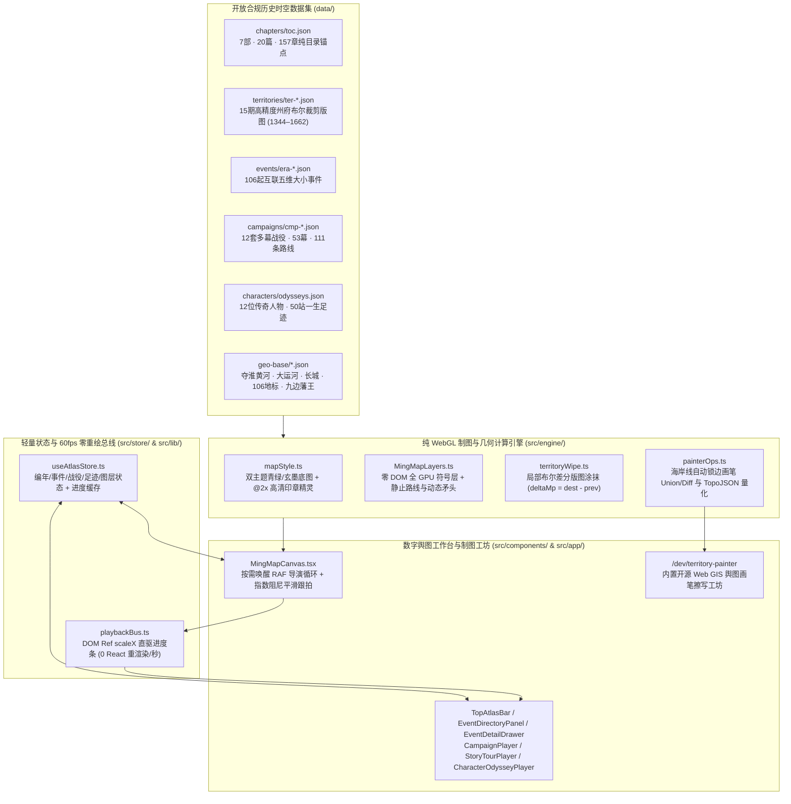

# 系统架构与关键引擎说明 (`docs/ARCHITECTURE.md`)

《明途 · 舆图纪》（`Those-Stories-of-Ming-map`）采用 **100% 纯 WebGL 矢量渲染（0 HTML DOM Marker）+ 局部布尔差分版图引擎 + 零重渲染播放总线 + 双轨容器化部署** 架构，在完整承载《明朝那些事儿》全七部（`1344–1662`）时空数据的同时，确保轻薄本核显与高分高刷屏均保持丝滑帧率与零待机功耗。

---

## 一、全栈模块拓扑图

---

## 二、五大核心技术引擎详解

### 1. 清零 HTML DOM Marker：100% 原生 WebGL GPU 符号渲染
传统 Web 地图在挂载上百个 HTML DOM `Marker` 时，每次拖拽、缩放或开启三维地形都会在主线程触发上百次 DEM 高程采样与 CSS 布局回流（Layout Reflow）。
- **`mapStyle.ts` 预烘焙 `@2x` 东方印章精灵**：在 Canvas 中离线绘制 `战 / 史 / 轶`（含常态与选中双环高亮态）、`决 / 围 / 伏 / 守 / 断` 战场印记及两京关隘图标，一次性注册进 WebGL 纹理图集。
- **`MingMapLayers.ts` 同城共址自动蛛网散开**：对南京（应天府）、北京（顺天府）等承载十余起事件的都城，在构建 `ming-events` 数据源时自动按当前缩放层级计算径向微偏移与虚线牵引丝，配合 MapLibre C++ 四象限符号避让（`text-variable-anchor`），实现 **全图 `0` 个 DOM Marker、拖拽飞行 `0 ms` 布局回流**。

### 2. 纯局部差分边境涂抹引擎 (`src/engine/territoryWipe.ts`)
跨时期切换或战役推进时，**绝不重绘或闪烁未发生变化的省域**：
- **政权连续性布尔求差**：通过 `polygon-clipping` 计算 `deltaMp = destPolityMp - unchangedSameRegimeMp`（并对退守无主地带生成 `isEraserOnly` 局部擦除区）。例如 `1582 → 1621` 仅辽东沈辽地区涂抹为后金，山海关内全境保持 100% 静止；`1402 → 1415` 仅安南交趾涂抹变色，两京十三省保持静止。
- **道格拉斯—普克瞬态加速**：涂抹动画的 `1.6s` 期间使用预简化缓存多边形（单帧布尔裁剪耗时 `< 1.5 ms`），同时利用上层 OpenMapTiles 矢量水体自动锁紧真实海岸线；动画收尾瞬间无缝锁入全精度州府边界切片。

### 3. 静止路线 +「动态箭矢 / 静态箭矢」双模控制
- **路线全程静止（`setCampaignStaticRoutesOnMap`）**：每幕加载时一次性写入完整贝塞尔战术路线，动画期间**绝不逐帧切割重建折线顶点缓冲区**，彻底消除虚线抖动与 3D 地形贴地纹理（Terrain Drape FBO）重栅格化开销。
- **双模箭矢按键（`CampaignArrowMode`）**：
  - **`动态箭矢`**：路线静止不动，仅 `campaign-vanguards` 点状矛头按历史先后次序 **`① → ② → ③`** 沿线平滑推进；
  - **`静态箭矢`**：路线与各终点矛头全部静态定格，零动态刷新。

### 4. 按需零闲置帧调度与 `playbackBus` 零 React 重绘架构
- **On-Demand Zero-Idle RAF**：静止阅读、切至后台标签页或切为「静态箭矢」暂停态时，`requestAnimationFrame` 自动退出休眠（**0 FPS 空转 / 0% 后台 CPU·GPU 占用**）。
- **`src/lib/playbackBus.ts`**：推演进度光带不再通过每秒刷新 Zustand 数值触发上百条目录列表与详情抽屉的 React 重渲染，而是通过轻量发布订阅直接驱动进度条 DOM `ref` 的 GPU 合成层 `transform: scaleX(...)`，将播放期每秒 React 组件树重渲染次数降至 **`0` 次**。
- **2.5D 常驻山体晕渲 + 按需 3D 立体网格**：默认开启低开销 `hillshade-dem`（2.5D 青绿立体山影），重度 `terrain-dem` 三维网格按需开启，且在动态版图涂抹瞬间自动挂起贴地 FBO 重绘，定格后无感恢复。

### 5. 内置开源 Web GIS 制图工具——「舆图画笔擦写工坊 (`/dev/territory-painter`)」
- 基于 `src/engine/painterOps.ts` 实现水墨画笔布尔扩张（`Union`）与橡皮擦除（`Difference`）；
- 自动绑定 `data/geo-base/land-mask-east-asia.json`（Natural Earth 10m 陆地掩膜）实现**海岸线自动锁边**与**相邻多政权边界自动互斥零重叠**；
- 支持考据底图半透明叠印描摹（Onion-Skin Overlay）、25 步 Undo/Redo，以及一键导出 `GeoJSON` 与量化压缩 `TopoJSON`。

---

## 三、双阶段零耦合部署架构

1. **云原生持续发布（Vercel）**：`main` 分支每次推送自动通过 GitHub Actions 校验并触发 Vercel 生产环境更新（`https://those-stories-of-ming-map.vercel.app`）。
2. **独立云服务器容器化生产套件（`deploy/`）**：
   - `deploy/Dockerfile` 采用三阶段构建，在镜像构建期强制执行 `npm run validate:data` 数据与版权审计，输出极简 Next.js `standalone` 运行时（内置 `/api/health` 探针）；
   - `deploy/docker-compose.yml` + `deploy/Caddyfile` 一键编排反向代理、Zstd/Gzip 压缩、静态资源长效缓存与免费 Let's Encrypt HTTPS 证书自动签发续期。
